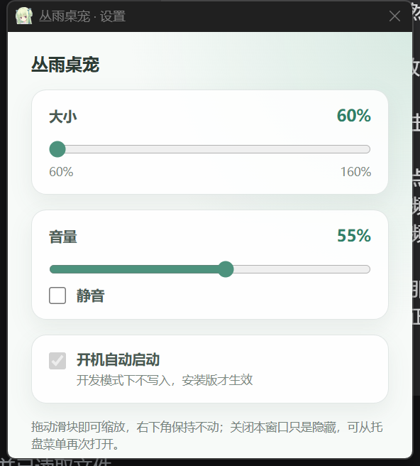
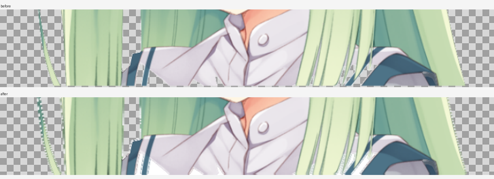

# 丛雨桌宠 · Murasame Desktop Pet

Windows 桌面宠物：透明无边框窗口、常驻置顶、纯本地运行，无后端、不联网。

技术栈：**Tauri 2 + Vue 3 + TypeScript**，Rust 侧只负责窗口、托盘和持久化。

## 功能

- **16 张表情**（千恋万花 · 丛雨半身立绘），透明背景，已处理掉原图自带的白描边
- **闲置轮换**：停在微笑，每 10 秒随机换一张
- **悬停反应**：鼠标进入切到「开心」，离开回到微笑
- **连击阶梯**：3 秒内连续点击会逐级切换表情（见下表）
- **点击防抖**：点击后 150ms 内的重复点击直接忽略，长按/连点不会一次跳好几级
- **拖动**：位移 ≥ 7px 或按住 220ms 才进入原生拖动，拖动不计入点击
- **位置与大小记忆**：重启回到原位；缩放 60%~160%，以右下角为锚点
- **托盘菜单**：显示 / 隐藏 / 设置… / 重置位置 / 退出；左键点托盘图标切换显隐；右键人物本身也能直接隐藏
- **设置窗**：缩放滑杆 + 开机自启开关，关闭只是隐藏
- **开机自启**：写入当前用户注册表 `Run` 项（`HKCU\...\CurrentVersion\Run\MurasameDesktopPet`），登录后自动出现
- **微动效**：闲置轻微呼吸（上下 2px + 缩放 0.6%，5.2s 一轮）、悬停上浮放大、点击回弹；纯 CSS 变换，并尊重系统「减少动态效果」设置
- **语音**：10 句台词，闲置切到特定表情、点击与连击时触发；同一时刻只播一条，正在播放时新的触发直接丢弃；设置窗可调音量/静音
- **多显示器**：物理像素尺寸恒定、跨屏 DPI 变化自动重算、显示前拉回屏内、重置回主屏

## 表情规则

| 触发 | 显示 | 10s 轮换 |
|---|---|---|
| 闲置 | 1（微笑） | 运行中：每 10s 从 1/5/6/7/8/9/10/14/15/16 随机 |
| 悬停 | 2（开心） | 暂停 |
| 连击 1~2 | 2 | 暂停 |
| 连击 3 | 8（ho~？） | 暂停 |
| 连击 4 | 4（生气） | 暂停 |
| 连击 5 | 3（震惊） | 暂停 |
| 连击 6 | 11（可恶） | 暂停 |
| 连击 7 及以上 | 13（大白鲨） | 暂停 |
| 3s 无点击 | 还悬停→2；已移开→1 | 从 1 重新起算 10s |

## 语音规则

音频是手工切好的 10 段（`src/assets/voice/01.mp3` ~ `10.mp3`，清单在同目录 `segments.json`）。

| 触发 | 播放 |
|---|---|
| 闲置轮换切到表情 **15** | 07 |
| 闲置轮换切到表情 **10** | 08 |
| 连击 1~2 | 01 / 02 / 03 / 05 随机，且不会连着播同一条 |
| 连击 3 | 04 |
| 连击 6 | 09 |
| 连击 7 及以上 | 10（只要前一条播完了，再点还会继续播） |

- 每条只在触发瞬间播一次；**同一时刻只播一条**，如果触发时上一条还没播完，这次触发直接丢弃（不会排队、不会打断）；
- 连击 4、5 不配音；
- 音量与静音在设置窗里调，状态存进 `pet-window.json`。

## 环境要求

| 依赖 | 说明 |
|---|---|
| Windows 10/11 | 仅支持 Windows |
| WebView2 Runtime | Win11 自带；Win10 可能需要安装 |
| Node.js ≥ 20 | 开发与构建 |
| Rust（stable，MSVC toolchain） | `rustup default stable-x86_64-pc-windows-msvc` |
| Visual Studio Build Tools | 勾选「使用 C++ 的桌面开发」+ Windows SDK |

## 开发

```powershell
npm install
npm run tauri dev
```

首次编译 Rust 依赖需要几分钟。前端支持热更新，Rust 改动会自动重编译重启。

其他脚本：

| 命令 | 作用 |
|---|---|
| `npm run dev` | 只起 Vite 前端（不带 Tauri 窗口，调试页面样式用） |
| `npm run check` | `vue-tsc --noEmit`，只做类型检查 |
| `npm run test:voice` | 语音触发规则的单元测试（`node --test`） |
| `npm run build` | 类型检查 + 打包前端到 `dist/` |
| `npm run tauri build` | 完整构建，出 exe 和安装包 |

## 构建

```powershell
npm run tauri build
```

产物：

- 安装包：`src-tauri/target/release/bundle/nsis/MurasameDesktopPet_0.2.0_x64-setup.exe`（约 6.5 MB）
- 免安装可执行文件：`src-tauri/target/release/murasame-desktop-pet.exe`（约 15 MB）

安装包未做代码签名，首次运行 Windows SmartScreen 会拦一下，点「更多信息 → 仍要运行」即可。

## 使用

- **拖动**：按住人物移动
- **点击**：单击换表情并随机播一句台词，快速连点解锁更多表情和台词
- **悬停**：鼠标停在人物上
- **右键人物**：立即隐藏（正在播的台词会停），点托盘图标再唤出
- **退出**：右下角托盘图标 → 右键 → 退出（关闭人物窗口只是隐藏）
- **改大小 / 音量 / 开机自启**：托盘图标 → 右键 → 设置…



## 配置

| 位置 | 内容 |
|---|---|
| `src/pet/config.ts` | 闲置间隔 10s、连击窗口 3s、点击防抖 150ms |
| `src/pet/voiceRules.ts` | 语音触发规则（表情/连击 → 片段编号） |
| `src/pet/expressionMachine.ts` | 表情状态机与连击阶梯 |
| `src-tauri/src/pet_window.rs` | 基准尺寸 480 物理像素、缩放范围 0.6~1.6、位置/缩放持久化 |
| `%APPDATA%\com.murasame.desktop-pet\pet-window.json` | 运行时状态：`{"x":…,"y":…,"scale":…,"volume":…,"muted":…}` |
| `HKCU\Software\Microsoft\Windows\CurrentVersion\Run\MurasameDesktopPet` | 开机自启项，由设置窗开关写入/删除 |

## 目录结构

```
.
├─ index.html                 桌宠页面入口
├─ settings.html              设置窗页面入口
├─ src/
│  ├─ main.ts                 桌宠窗口挂载入口
│  ├─ App.vue                 桌宠窗口：渲染表情 + 指针事件（点击/拖动）
│  ├─ styles.css              透明背景、图片贴合窗口底部
│  ├─ pet/
│  │  ├─ config.ts            时间参数
│  │  ├─ expressions.ts       表情索引 → 图片，含预加载
│  │  ├─ expressionMachine.ts 纯状态机（可单测，时钟可注入）
│  │  ├─ useExpression.ts     状态机 ↔ Vue 响应式
│  │  ├─ voice.ts             音频播放（单元素，不打断）
│  │  ├─ voiceRules.ts        表情/连击 → 片段编号
│  │  └─ voiceTrigger.ts      播不播的判定（可单测）
│  ├─ settings/               设置窗（缩放 / 音量 / 开机自启）
│  ├─ assets/pet/             01.png ~ 16.png + manifest.json
│  └─ assets/voice/           01.mp3 ~ 10.mp3 + segments.json
├─ src-tauri/
│  ├─ tauri.conf.json         窗口配置（透明/置顶/尺寸/CSP）
│  ├─ capabilities/           权限（pet + settings 窗口）
│  └─ src/
│     ├─ main.rs              程序入口
│     ├─ lib.rs               命令注册、事件、位置落盘
│     ├─ pet_window.rs        窗口定位/缩放/多屏夹取 + 单元测试
│     └─ tray.rs              托盘菜单
├─ tools/
│  ├─ remove_outline.py       单张图去白描边
│  ├─ batch_remove_outline.py 批量处理表情包
│  ├─ finish_bottom.py        底部补回衣服 + 裁白条（见「素材处理」）
│  ├─ split_mp3.py            按转录时间轴切分台词
│  ├─ adjust_clip.py          微调某一段的起止
│  └─ test-voice-trigger.ts   语音触发规则的单测
└─ docs/                      README 用的对比图
```

## 素材处理

原图是「从雨表情包2.0」的 16 张 PNG，自带约 10px 纯白描边，在深色壁纸上会像贴纸边框。处理流程：

1. 判白：RGB 三通道都 ≥ 235 且不透明；
2. 从**贴着透明背景的白色像素**出发，只沿白色像素扩散，凡是能走到的都算描边、整片切掉（顶部突起的白三角、底部白条这类边角也能一并清掉）；
3. 人物内部的白色（衬衫、高光）走不到——中间隔着非白像素——因此会被完整保留；
4. **默认只切不补**：发丝之间的白缝会变成细透明缝，不会让发丝看起来变粗；
5. 可选 `--repaint-inner`：把因遮挡而封闭的白条用邻近颜色补上，避免透明细缝（代价是发丝略粗）；
6. 重建 0.7px 抗锯齿，并把颜色向外扩，防止新边缘吸白；
7. 底部单独处理（`finish_bottom.py`）：原图是齐胸截断的，白边正压在切口上，和衬衫是同一片白色，靠局部规则分不开。所以先把底部一条带里被切掉的像素**从原图整体补回**（这里确实是衣服），再裁掉底部那条 8px 纯白贴纸条，最后在该带内重跑一次「切掉与背景连通的白」，把补回来的描边毛边重新去掉。这样衣服完整、白条也干净。底部没有白条的 5 张（11、12、13、15、16）会被自动跳过，输出与批处理结果完全一致。



重新生成（需要 Python 3.10+ 以及 `Pillow`、`numpy`）：

```powershell
python tools\batch_remove_outline.py "素材目录" src\assets\pet
python tools\finish_bottom.py "素材目录" src\assets\pet
# 需要补色模式时：
python tools\batch_remove_outline.py "素材目录" src\assets\pet --repaint-inner
```

### 语音切分

台词按转录里的 `起始 - 结束` 区间切，只在 MPEG 帧边界下刀，不重新编码：

```powershell
python tools\split_mp3.py "狗修金纯享.mp3" "狗修金纯享.txt" "输出目录"
python tools\adjust_clip.py "狗修金纯享.mp3" "输出目录" "05.mp3" --start 0.1 --end -0.05
```

`split_mp3.py` 输出 `01.mp3`… 和 `segments.json`（含起止时间、日文、中文），`adjust_clip.py` 用来微调某一段的起止（正数往后、负数往前，帧粒度约 24ms）。

## 已知限制

- 悬停按窗口矩形判定，人物周围的透明角落也会触发
- 16 张图有 727×725 / 750×750 / 752×751 三种画布（底部裁过白条的那 11 张是 727×725），切换时约 3% 缩放差异（未做归一化）
- 多显示器相关逻辑（跨屏 DPI、拔屏兜底）有单元测试，但尚未在真实双屏环境验证
- 暂未支持：单实例、全屏应用避让、逐像素命中（点击穿透）
- 眨眼未做：16 张都是整张立绘，眼睛区域无法单独替换。试过把 05 的闭眼区域合成到其他表情上（[试验图](docs/blink-attempt.png)），因为眼位和压在脸上的发丝不完全一致会穿帮，需要专门补一张闭眼素材才能做
- 开机自启用的是注册表 `Run` 项：开发模式（`tauri dev`）下不写入，避免登记一个依赖 Vite 的调试程序；卸载程序也不会自动删掉这一项，换机器或不再需要时在设置里关一次即可

## 版权

- 角色「丛雨」及游戏美术版权归 **Yuzusoft** 所有
- 语音台词同样出自游戏，版权归 **Yuzusoft**，本项目只做本地播放
- 表情包为同人作品，版权归原作者
- 本项目仅供个人学习与自用，请勿分发素材或打包发布

代码部分可自由取用。
